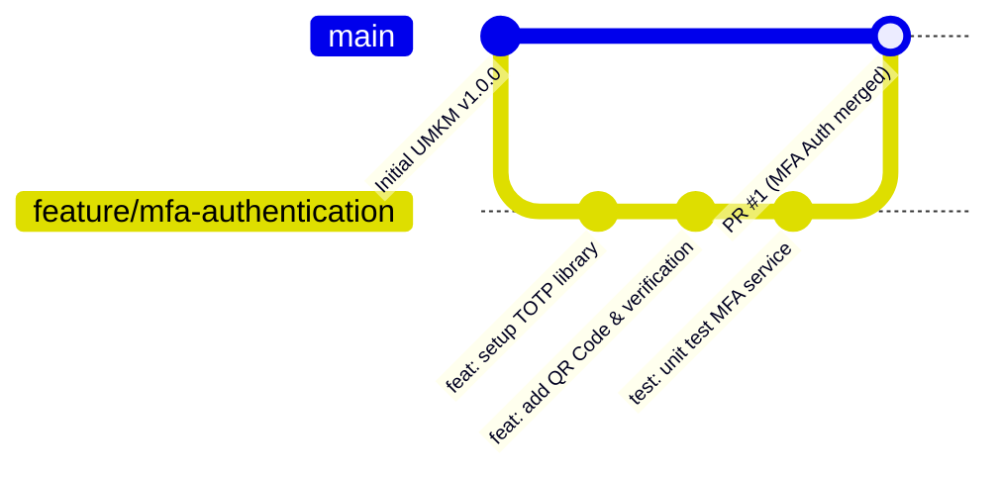

# Lembar Jawaban Sumatif Tengah Semester (STS)
## Mata Pelajaran: Pengembangan Perangkat Lunak dan GIM (PPLG)
### Topik: Version Control System (Git & GitHub) - Feature Branch Workflow

---

| Informasi Siswa | Detail |
| :--- | :--- |
| **Nama Lengkap** | Muhammad Iqbal |
| **Kelas** | XII PPLG 1 |
| **Kompetensi Keahlian** | Pengembangan Perangkat Lunak dan GIM (PPLG) |
| **Branch Pengerjaan** | `jawaban-iqbal_xii_pplg_1` |
| **Nama File Jawaban** | `M.Iqbal_XII_PPLG_1.md` |
| **Repository Asal (Upstream)** | [https://github.com/Japar-sodik/sts_version_control.git](https://github.com/Japar-sodik/sts_version_control.git) |

---

## 📌 Studi Kasus & Skenario
- **Topik Studi Kasus**: Penerapan Fitur Baru (*Feature Branch Workflow*)
- **Skenario Proyek**:
  > *Dalam proyek akhir Pembuatan Website untuk UMKM, ketua tim melarang keras anggota melakukan commit langsung ke branch main untuk menghindari kegagalan sistem operasional (production crash). Anda ditugaskan membuat fitur baru yaitu 'Autentikasi Multi-faktor (MFA)'.*

---

## 📝 Jawaban Pertanyaan 1: Keuntungan Utama Pembatasan Branch `main`

Pembatasan *branch main* (melarang commit/push langsung) merupakan *best practice* fundamental dalam rekayasa perangkat lunak modern. Berikut adalah keuntungan-keuntungan utamanya:

### 1. Menjaga Integritas & Stabilitas Sistem Operasional (*Production Stability / Zero-Downtime*)
Branch `main` mencerminkan versi kode yang sedang berjalan secara langsung (*live production*) dan digunakan oleh klien atau konsumen website UMKM. 
- Apabila anggota tim bebas melakukan commit langsung tanpa melalui tahap pengujian, bug kecil, salah ketik (*typo*), atau kegagalan konfigurasi dapat langsung memicu kegagalan sistem operasional (*production crash*).
- Pada website UMKM, *downtime* atau *crash* dapat menghentikan transaksi penjualan, menghilangkan kepercayaan pembeli, dan menimbulkan kerugian finansial.
- Dengan pembatasan ini, branch `main` dijamin selalu dalam kondisi *production-ready* (stabil, bersih dari *error*, dan siap dirilis setiap saat).

### 2. Penegakan Mekanisme Peninjauan Kode (*Code Review & Peer Review*)
Dengan melarang *push* atau *commit* langsung ke `main`, seluruh penambahan kode wajib diajukan melalui mekanisme **Pull Request (PR)** atau **Merge Request (MR)**.
- **Deteksi Bug Lebih Awal (*Early Bug Detection*)**: Rekan tim atau *Tech Lead* dapat memeriksa baris kode (*diff*), logika bisnis, dan keamanan sebelum kode digabungkan.
- **Standarisasi Kualitas Kode (*Code Quality & Consistency*)**: Memastikan arsitektur kode, penamaan variabel, struktur modular, dan dokumentasi selaras dengan standar tim.
- **Pertukaran Pengetahuan (*Knowledge Sharing*)**: Setiap anggota tim dapat saling mempelajari implementasi fitur baru (seperti alur autentikasi MFA ini) sehingga tidak ada ketergantungan pada satu orang saja (*no single point of failure*).

### 3. Otomatisasi Pengujian & Validasi CI/CD (*Continuous Integration*)
Pembatasan branch `main` dipadukan dengan aturan perlindungan (*Branch Protection Rules*) memungkinkan integrasi dengan alat CI/CD otomatis (misalnya GitHub Actions).
- Setiap kali ada *Pull Request*, sistem otomatis menjalankan *Unit Testing*, *Integration Testing*, *Code Linter*, dan pemindaian celah keamanan (*Security Scanning*).
- Jika salah satu tes gagal (*test failed*), penggabungan ke branch `main` akan diblokir otomatis sampai masalah tersebut diperbaiki oleh pengembang.

### 4. Mengisolasi Lingkungan Pengembangan (*Isolated Feature Development*)
Setiap fitur (dalam skenario ini: 'Autentikasi Multi-faktor (MFA)') dikerjakan pada cabangnya sendiri (*Feature Branch*).
- Pengembang memiliki kebebasan penuh untuk bereksperimen, menambah library, dan melakukan commit lokal berkali-kali tanpa khawatir merusak kode yang sedang dikerjakan anggota tim lain.
- Fitur yang masih dalam tahap *work-in-progress* (WIP) tidak akan menghalangi perilisan fitur lain yang sudah selesai.

### 5. Meminimalisir dan Mempermudah Penanganan Konflik Kode (*Merge Conflicts*)
Jika seluruh anggota tim langsung menulis dan melakukan commit ke branch `main`, konflik kode (*merge conflict*) akan sangat sering terjadi dan sulit ditelusuri siapa yang menimpa baris kode siapa.
- Dengan Feature Branch Workflow, penyelesaian konflik dilakukan secara terisolasi di branch fitur pengembang melalui sinkronisasi lokal (*rebase* atau *merge*) sebelum kode disatukan ke `main`.

### 6. Riwayat Perubahan yang Bersih, Akuntabel, dan Kemudahan *Rollback* (*Audit Trail*)
- Riwayat commit (*git log*) pada branch `main` tetap ringkas dan memiliki dokumentasi yang jelas dari setiap Pull Request yang digabungkan (*merge commit* atau *squashed commit*).
- Jika di masa depan terjadi masalah tak terduga, tim dapat melakukan pelacakan dengan cepat (*git blame* / *git bisect*) dan melakukan pembatalan (*rollback*) dengan aman menggunakan `git revert` tanpa mengacaukan progres fitur lain.

---

## 💻 Jawaban Pertanyaan 2: Rangkaian Perintah Git (Feature Branch Workflow)

Berikut adalah simulasi alur perintah Git lengkap mulai dari sinkronisasi awal, pembuatan branch fitur `feature/mfa-authentication`, penyimpanan progres lokal berstandar *Conventional Commits*, hingga pengiriman ke remote repository (GitHub) agar siap ditinjau via Pull Request.

### Alur Visual Diagram Git (Feature Branch Workflow)


---

### Tahapan & Perintah Git Lengkap:

#### Langkah 1: Memastikan Sinkronisasi dengan Branch Utama Terkini
Sebelum memulai pembuatan fitur, pastikan branch utama lokal sinkron dengan kode terbaru di remote repository agar kita tidak bercabang dari kode usang.

```bash
# Berpindah ke branch utama (main)
git checkout main

# Menarik dan menggabungkan pembaruan terkini dari remote
git pull origin main
```
> *Catatan: Pada Git versi 2.23+, perintah `git switch main` dapat digunakan sebagai alternatif yang lebih modern dan aman.*

---

#### Langkah 2: Membuat dan Berpindah ke Branch Fitur Terpisah
Buat branch baru dengan nama yang deskriptif menggunakan standar penamaan industri (`feature/<nama-fitur>`). Dalam hal ini: `feature/mfa-authentication`.

```bash
# Membuat branch baru sekaligus berpindah ke branch tersebut
git checkout -b feature/mfa-authentication
```
> *Alternatif perintah modern:*
> ```bash
> git switch -c feature/mfa-authentication
> ```

---

#### Langkah 3: Mengembangkan Fitur Autentikasi Multi-faktor (MFA)
Pada langkah ini, pengembang menulis kode fitur baru, seperti:
- Menambahkan dependensi generator token TOTP (*Time-based One-Time Password*).
- Membuat skema database untuk menyimpan *MFA secret key*.
- Menyiapkan UI pemindaian QR Code dan form input kode verifikasi OTP 6 digit.
- Menambahkan middleware validasi login dua langkah (*Two-Factor Authentication*).

---

#### Langkah 4: Memeriksa Status dan Perubahan Berkas
Sebelum menyimpan progres, selalu periksa status berkas di direktori kerja (*working directory*).

```bash
# Memeriksa daftar file yang dimodifikasi, ditambahkan, atau belum terlacak
git status

# Meninjau perbedaan detail baris kode yang diubah
git diff
```

---

#### Langkah 5: Menambahkan Perubahan ke Staging Area (*Staging*)
Tandai berkas-berkas yang telah selesai dikerjakan agar masuk ke area persiapan (*staging area*).

```bash
# Menambahkan seluruh file perubahan terkait fitur MFA
git add .

# Atau jika ingin memilih file tertentu secara spesifik:
# git add src/services/mfaService.js src/controllers/authController.js
```

---

#### Langkah 6: Menyimpan Progres Lokal dengan Commit Terstruktur
Gunakan format pesan commit terstruktur mengikuti konvensi **Conventional Commits** (`type(scope): description`) agar deskriptif dan profesional.

```bash
# Menyimpan snapshot perubahan ke repositori lokal
git commit -m "feat(auth): implement multi-factor authentication (MFA) with TOTP"
```

*(Jika pengembangan dilakukan secara bertahap, commit dapat dibagi menjadi beberapa unit logis, contohnya saat menambahkan unit test)*:
```bash
git add tests/
git commit -m "test(auth): add unit tests for MFA token validation flow"
```

---

#### Langkah 7: Sinkronisasi Ulang Sebelum Push (*Best Practice*)
Untuk memastikan branch fitur kita tidak tertinggal dari perubahan baru yang mungkin telah di-merge oleh anggota tim lain ke branch `main`, lakukan *fetch* dan *rebase* (atau *merge*).

```bash
# Mengambil update metadata terbaru dari remote
git fetch origin

# Melakukan rebase branch fitur kita di atas commit terbaru branch main
git rebase origin/main
```

---

#### Langkah 8: Mengirimkan (*Push*) Branch Fitur ke GitHub
Unggah branch fitur lokal ke remote repository di GitHub. Sertakan flag `-u` (*--set-upstream*) pada pengiriman pertama agar branch lokal melacak branch remote yang bersangkutan.

```bash
# Mendorong branch fitur ke repository remote di GitHub
git push -u origin feature/mfa-authentication
```

---

#### Langkah 9: Membuka dan Mengajukan Pull Request (PR) di GitHub
Setelah branch fitur berhasil berada di GitHub, ajukan Pull Request agar ketua tim dan tim pengembang dapat melakukan peninjauan:
1. Buka halaman repositori proyek di browser GitHub.
2. Klik tombol **"Compare & pull request"** yang otomatis muncul pada banner notifikasi branch `feature/mfa-authentication`.
3. Tentukan konfigurasi branch:
   - **Base repository / branch**: `main` (branch tujuan penggabungan).
   - **Head repository / branch**: `feature/mfa-authentication` (branch fitur yang berisi kode MFA).
4. Isi judul dan rincian deskripsi PR:
   - **Title**: `feat(auth): Implementasi Fitur Autentikasi Multi-faktor (MFA)`
   - **Deskripsi**:
     - *Ringkasan Fitur*: Menambahkan autentikasi dua langkah (TOTP) untuk meningkatkan keamanan akun UMKM.
     - *Daftar Perubahan*: Modul pembuatan secret key, rendering QR Code, verifikasi token 6 digit, dan middleware proteksi rute dashboard.
     - *Cara Pengujian*: Uji coba pendaftaran MFA via aplikasi authenticator (Google Authenticator / Authy) dan verifikasi token saat login.
5. Tetapkan (*Assign*) Ketua Tim / Tech Lead pada bagian **Reviewers**.
6. Klik **"Create pull request"**.
7. Menunggu hasil review; jika disetujui (*Approved*) dan lolos uji CI/CD, ketua tim akan melakukan **Merge Pull Request** ke branch `main`.

---

## 📊 Tabel Rangkuman Perintah Git & Fungsinya

| No | Perintah Git | Kategori Alur | Fungsi & Penjelasan Singkat |
| :-: | :--- | :--- | :--- |
| **1** | `git checkout main` | Persiapan | Berpindah ke branch utama (`main`) lokal. |
| **2** | `git pull origin main` | Sinkronisasi | Mengambil & menyatukan pembaruan kode terbaru dari remote `main`. |
| **3** | `git checkout -b feature/mfa-authentication` | Percabangan | Membuat branch baru `feature/mfa-authentication` dan langsung berpindah ke dalamnya. |
| **4** | `git status` | Verifikasi | Memeriksa status berkas (untracked, modified, staged) di direktori kerja. |
| **5** | `git diff` | Verifikasi | Memeriksa detail perbedaan baris kode sebelum dimasukkan ke staging area. |
| **6** | `git add .` | Staging | Memasukkan seluruh berkas perubahan ke Staging Area Git. |
| **7** | `git commit -m "feat(auth): ..."` | Snapshot Lokal | Menyimpan perubahan ke riwayat Git lokal dengan pesan terstruktur. |
| **8** | `git fetch origin` | Sinkronisasi | Mengunduh informasi perubahan terbaru dari remote tanpa langsung menggabungkan. |
| **9** | `git rebase origin/main` | Sinkronisasi | Menata ulang basis commit branch fitur di atas commit terbaru branch `main`. |
| **10** | `git push -u origin feature/mfa-authentication` | Publikasi Remote | Mengunggah branch fitur ke GitHub dan mengaitkan tracking upstream. |

---

## 📋 Prosedur Pengumpulan Tugas STS Ini

Berikut adalah alur pengumpulan tugas sesuai instruksi guru:

| Tahap | Status | Keterangan |
| :--- | :---: | :--- |
| **1. Fork & Clone** | ✅ Selesai | Repository di-fork ke `iqbaliqbalnew15286/sts_version_control` dan di-clone ke komputer lokal. |
| **2. Buat Branch Baru** | ✅ Selesai | Branch pengerjaan dibuat dengan nama `jawaban-iqbal_xii_pplg_1`. |
| **3. Kerjakan Soal** | ✅ Selesai | File `M.Iqbal_XII_PPLG_1.md` telah dibuat di root proyek dan diisi jawaban lengkap. |
| **4. Commit & Push** | ⏳ Menunggu Review Siswa | Perintah siap dieksekusi setelah siswa memverifikasi isi file jawaban:<br>`git add M.Iqbal_XII_PPLG_1.md`<br>`git commit -m "docs: submit jawaban STS version control M. Iqbal XII PPLG 1"`<br>`git push -u origin jawaban-iqbal_xii_pplg_1` |
| **5. Pull Request (PR)** | ⏳ Tahap Akhir | Mengajukan PR dari `iqbaliqbalnew15286:jawaban-iqbal_xii_pplg_1` ke `Japar-sodik:String` (atau branch utama guru) di GitHub. Tautan PR dikirimkan sebagai bukti pengumpulan. |
